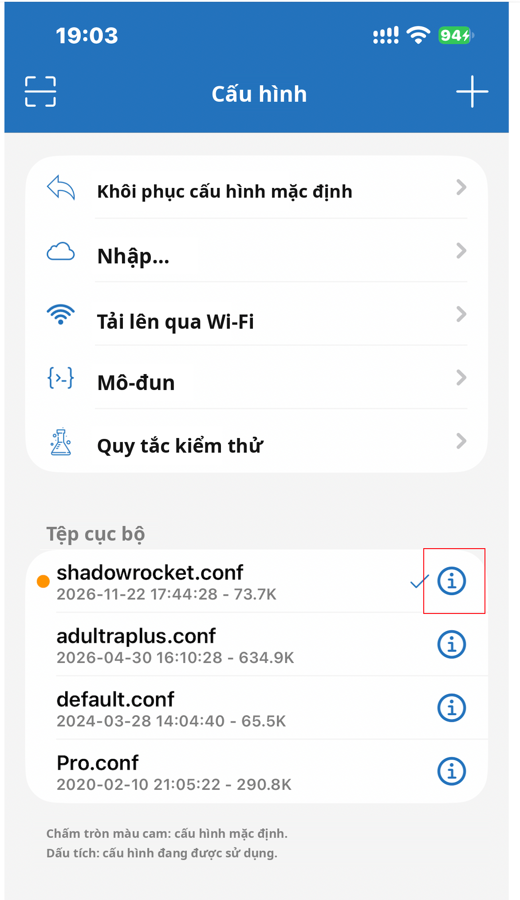
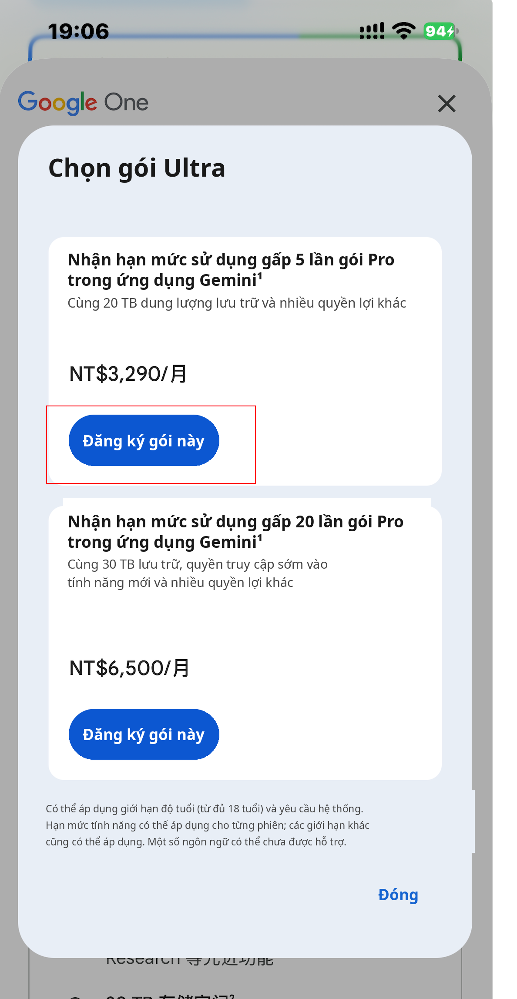

# g1-acq

> Mô-đun ánh xạ mã sản phẩm dành cho trang đăng ký Google One (iOS), sử dụng với **Shadowrocket**.

Trong phản hồi của trang đăng ký `one.google.com/ai`, mô-đun thay mã mua hàng trong ứng dụng iOS gốc của hai gói thanh toán hằng tháng 20 TB và 30 TB bằng mã của các gói ưu đãi đang tồn tại. Nhờ đó, bảng chọn gói có thể mở trang thanh toán App Store bằng mã gói ưu đãi.

> Mô-đun chỉ thay chuỗi mã sản phẩm trong nội dung phản hồi. Khả năng đặt mua thực tế, giá và quyền lợi cuối cùng phải được xác nhận tại bảng thanh toán App Store và trong trạng thái tài khoản Google One.

---

## Địa chỉ mô-đun (điện thoại chỉ cần thêm dòng này)

```text
https://cdn.jsdelivr.net/gh/crhywun/g1-acq@main/g1-acq.sgmodule
```

Địa chỉ script (đã được tham chiếu bên trong mô-đun, không cần thêm riêng):

```text
https://cdn.jsdelivr.net/gh/crhywun/g1-acq@main/g1-acq.js
```

## Bảng ánh xạ mã sản phẩm

| Mã mua hàng iOS gốc | Mã thay thế | Mô tả |
|---|---|---|
| `g1.ios.20tb.m.v2` | `g1.20tb.3months_ip_90p.acq` | Gói 20 TB thanh toán hằng tháng → gói ưu đãi |
| `g1.ios.30tb.ai.pro.m` | `g1.ai.ultra.3months_ip_90p.acq` | Gói 30 TB AI Pro thanh toán hằng tháng → gói ưu đãi AI Ultra |

Hai mã gói ưu đãi phải thực sự xuất hiện trong danh mục sản phẩm của phản hồi thì script mới thay thế. Nếu mã gói chính không có trong danh mục nhưng mã dự phòng (75p) có mặt, script sẽ tự động chuyển sang mã dự phòng:

| Gói chính (90p) | Gói dự phòng (75p) |
|---|---|
| `g1.20tb.3months_ip_90p.acq` | `g1.20tb.3months_ip_75p.acq` |
| `g1.ai.ultra.3months_ip_90p.acq` | `g1.ai.ultra.3months_ip_75p.acq` |

Mã gói ưu đãi thuộc các chương trình khuyến mãi có thời hạn; tên và cấp gói có thể thay đổi theo chương trình của Google. Nhật ký dò danh mục sẽ liệt kê tất cả mã ưu đãi thực sự có trong phản hồi hiện tại. Hãy căn cứ vào nhật ký để cập nhật hoặc loại bỏ mã trong `SKU_MAP`.

## Cài đặt (Shadowrocket)

Mở phần **Giải mã HTTPS** trong cài đặt: vào trang Cấu hình → nhấn biểu tượng **(i)** ở bên phải cấu hình đang sử dụng → tìm mục **Giải mã HTTPS** trong màn hình chỉnh sửa cấu hình vừa mở.



1. Giữ VPN ở trạng thái bật tại trang chủ.
2. Vào **Cài đặt → Giải mã HTTPS** (MITM) → bật công tắc chính → tại mục chứng chỉ, chọn tạo và cài đặt. Sau đó hoàn tất hai bước trong iOS:
   - **Cài đặt → Cài đặt chung → VPN & Quản lý thiết bị** → cài đặt hồ sơ Shadowrocket.
   - **Cài đặt → Cài đặt chung → Giới thiệu** → **Cài đặt tin cậy chứng chỉ** → bật tin cậy cho chứng chỉ gốc Shadowrocket. Nếu bỏ qua bước này, giải mã HTTPS sẽ không hoạt động.
3. Trong danh sách hostname của trang Giải mã HTTPS, kiểm tra xem đã có `one.google.com` chưa (khi bật mô-đun, hostname này sẽ được tự động thêm). Nếu nhật ký không xuất hiện dòng `[g1-acq]` và kết nối vẫn hiển thị là chưa giải mã, hãy thêm `one.google.com` vào cuối danh sách hostname theo cách thủ công.
4. Vào **Cấu hình → Mô-đun → dấu `+` ở góc trên bên phải** → dán địa chỉ mô-đun ở trên → cài đặt.
5. Kiểm tra công tắc mô-đun đã bật, sau đó nhấn giữ để kết nối lại một lần.

> Tên mục có thể hơi khác tùy phiên bản Shadowrocket và ngôn ngữ giao diện.

## Phạm vi hoạt động

- **Khớp URL:** `^https://one\.google\.com/ai\?` — chỉ áp dụng cho trang đăng ký, không chặn hoặc xử lý toàn bộ website.
- **MITM (Cài đặt → Giải mã HTTPS):** hostname `one.google.com`.
- **Chặn QUIC:** mô-đun có quy tắc chặn UDP 443 để tránh Google App sử dụng HTTP/3 và đi vòng qua quá trình giải mã HTTPS.

## Cách sử dụng (trên điện thoại)

1. Mở **ứng dụng Google** (biểu tượng chữ G nhiều màu) → ảnh đại diện → **Quản lý Google One** để vào trang quản lý đăng ký. Mô-đun xử lý phản hồi `/ai` do chính trang này gửi đi.
2. Trong bảng chọn gói Ultra, nhấn trực tiếp **“Đăng ký gói này”** ở gói 20 TB. Bảng thanh toán App Store sẽ được mở bằng mã gói ưu đãi. Gói 30 TB thực hiện tương tự.



> **Lưu ý:** Trang đăng ký mở từ ứng dụng Google One độc lập sử dụng API gốc, nằm ngoài phạm vi xử lý của mô-đun này. Hãy mở **Quản lý Google One bên trong ứng dụng Google**.

## Kiểm tra và khắc phục sự cố

Vào **Dữ liệu → Nhật ký → Proxy**, sau đó tìm `g1-acq`:

| Nội dung nhật ký | Ý nghĩa |
|---|---|
| `[g1-acq] v6 loaded` | Script đã được tải; phiên bản đang chạy là v6. |
| `Gói ưu đãi trong danh mục: ...` | Các mã gói ưu đãi thực sự có trong phản hồi. |
| `Gói chính không có trong danh mục, chuyển sang dự phòng ...` | Mã gói chính không có trong danh mục; script đã tự động chuyển sang mã dự phòng. |
| `Đã thay thế N vị trí` | Đã thực hiện thay thế tại N vị trí. |
| Không có dòng nào chứa `g1-acq` | Script chưa được kích hoạt. Kiểm tra VPN, Giải mã HTTPS (đã cài chứng chỉ và bật tin cậy), cùng công tắc mô-đun. |

Sau khi chỉnh sửa `SKU_MAP`: chạy `git push` từ máy tính, rồi xóa bộ nhớ đệm Shadowrocket trên điện thoại (**Dữ liệu → Xóa tất cả dữ liệu**) và kết nối lại để tải script mới. jsDelivr có thể lưu bộ nhớ đệm trong vài phút; có thể chủ động xóa bộ nhớ đệm tại:

```text
https://purge.jsdelivr.net/gh/crhywun/g1-acq@main/g1-acq.js
```

## Quyền truy cập và giới hạn bảo mật

- **Phạm vi có thể đọc của lưu lượng:** script chỉ khớp phản hồi HTTP của `one.google.com/ai`, có thể đọc và sửa nội dung phản hồi của trang này. Script không đọc hoặc sửa lưu lượng của bất kỳ tên miền nào khác.
- **Không gửi dữ liệu ra ngoài:** script không chứa các lời gọi mạng như `$httpClient`; mọi thông tin đầu ra chỉ được ghi vào nhật ký cục bộ trên điện thoại.
- **Phạm vi MITM:** chỉ bổ sung một hostname là `one.google.com`. Chứng chỉ CA được tạo và lưu trên thiết bị của người dùng; tác giả mô-đun không thể lấy chứng chỉ này.
- **Quyền hệ thống:** mô-đun không yêu cầu quyền iOS như thông báo, vị trí hoặc thư viện ảnh. Thao tác cài đặt chỉ diễn ra bên trong Shadowrocket.
- **Ảnh hưởng toàn hệ thống:** quy tắc trong `[Rule]` chặn UDP 443 trên toàn thiết bị (QUIC), có thể ảnh hưởng tốc độ truy cập HTTP/3 của tất cả ứng dụng. Đây là ảnh hưởng về kết nối/hiệu năng, không phải cơ chế thu thập dữ liệu riêng tư.
- **Mô hình tin cậy:** địa chỉ script trỏ tới kho GitHub và CDN jsDelivr. Khi cài đặt, người dùng tin cậy các thay đổi về sau của chủ sở hữu kho mã. Về lý thuyết, một phiên bản độc hại tối đa có thể truy cập cookie và dữ liệu trang thuộc riêng miền `one.google.com/ai`; các website khác nằm ngoài phạm vi này. Người dùng có thể kiểm tra mã nguồn vì dự án được công khai. Khi phân phối, có thể thay `@main` bằng mã commit cụ thể để cố định phiên bản không thay đổi.

## Các tệp trong dự án

| Tệp | Công dụng |
|---|---|
| `g1-acq.sgmodule` | Mô-đun Shadowrocket (quy tắc, tham chiếu script và cấu hình MITM). |
| `g1-acq.js` | Script sửa nội dung phản hồi (v6). |

## Tùy chỉnh

- **Thêm hoặc xóa cấp gói:** chỉ chỉnh sửa hai bảng `SKU_MAP` và `FALLBACK` ở đầu tệp `g1-acq.js`.
- **Thay đổi giá:** hiện chưa triển khai chức năng sửa trường giá. Nếu cần, có thể bổ sung thao tác thay thế biểu thức chính quy cho `price_amount_micros` sau vòng lặp thay mã.
- Script không có chức năng báo cáo dữ liệu ra ngoài và không phụ thuộc thư viện bên ngoài.
